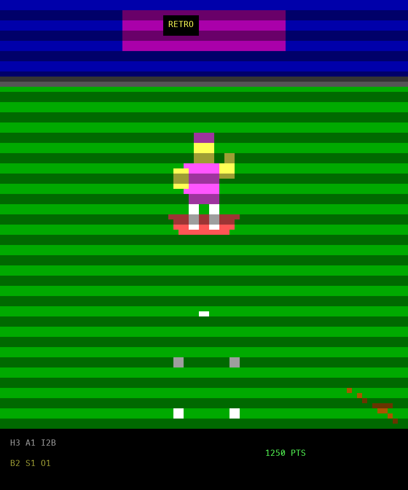
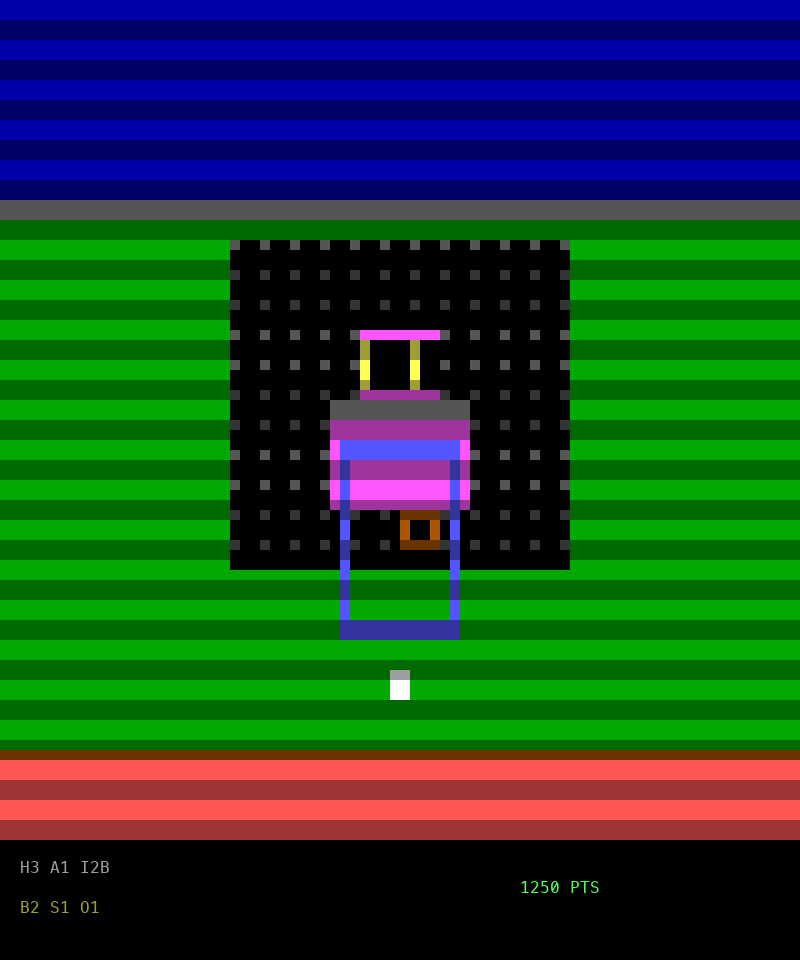

# Retro Diamond: Optical Arcade

A touchless arcade baseball game. A standard webcam is the only controller —
no keyboard, mouse, or gamepad. Step in front of the camera, swing your arms
to bat, throw toward the lens to pitch.

## What it is

- **Genre:** touchless arcade sports sim, late-1970s home-console aesthetic
  (chunky 8-bit sprites, ANSI terminal renderer, square-wave synth audio).
- **Input:** monocular RGB webcam at 720p60. Optical pose estimation tracks
  9 upper-body landmarks (nose, shoulders, elbows, wrists, hips) every frame.
- **Modes:** Batter mode (stance, swing timing/power, launch angle, check
  swings) and Pitcher mode (reticle aim, pose-selected pitch type, arm-speed
  velocity, follow-through break).
- **Rules:** condensed arcade baseball — 3-inning games, 1-1 starting counts,
  automated baserunning/fielding, role-swap half-innings, 10-run mercy rule,
  plus an arcade points layer (100–2,500 pt bonuses, multipliers).

## Repo layout

| Path | Contents |
|---|---|
| `description.md` | Original game concept brief |
| `architecture.md` | Technical spec: state machine, kinematics, rules, scoring |
| `agentAssignment.md` | Agent model-routing plan used during the build |
| `BUILD_CONTRACT.md` | Locked build contract: env facts, wire protocol, APIs, numbers |
| `DESIGN.md` | Design summary and build/test decision log |
| `client/` | Terminal client: OpenCV capture, OpenVINO pose, ANSI render, synth audio |
| `server/` | Game server (stdlib-only): FSM, kinematics, rules, NDJSON TCP server |
| `evals/` | 100-pt spec rubric (7 scenarios) + screenshot harness |
| `tests/` | Pytest suite (95 tests) |
| `models/` | OpenVINO pose model + test photo for replay mode |
| `asd-ste100/` | Progress report (`index.html`) + eval-run screenshots (`shots/`) |

## Status

Working prototype, all milestones M0–M4 complete. Verified this doc run:
**evals 100/100 (PASS, threshold 90), pytest 95 passed**, zero `random`
usage, live client↔server replay run green. See
[asd-ste100/index.html](asd-ste100/index.html) for the full progress report
with screenshots, and [DESIGN.md](DESIGN.md) for design and decisions.
Remaining: human live-camera run + audio check (see report).




## Quickstart

```bash
source .venv/bin/activate
# terminal 1: server
python -m server --port 8765 --innings 3
# terminal 2: client (headless replay — no camera needed)
python -m client.main --server 127.0.0.1 --port 8765 --replay models/person.jpg --no-audio
# client with live camera (click Allow on the macOS prompt):
python -m client.main --server 127.0.0.1 --port 8765
# gates:
python -m pytest tests/ -q
python evals/run_evals.py --json /tmp/eval.json --threshold 90
```

## Requirements

- Python 3.14, project env `.venv/` (`pip install -r client/requirements.txt`
  plus pytest: numpy, opencv-python-headless, openvino)
- Webcam: 720p @ 60fps for live play (replay mode works headless)
- Play space: 4 ft wide x 6 ft deep, 4–7 ft from the display
- 80-column terminal, dark background (auto-fits 24/48/96-row windows)
- macOS `afplay` for audio (`--no-audio` fallback otherwise)
